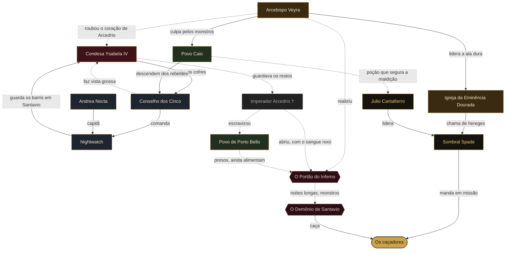
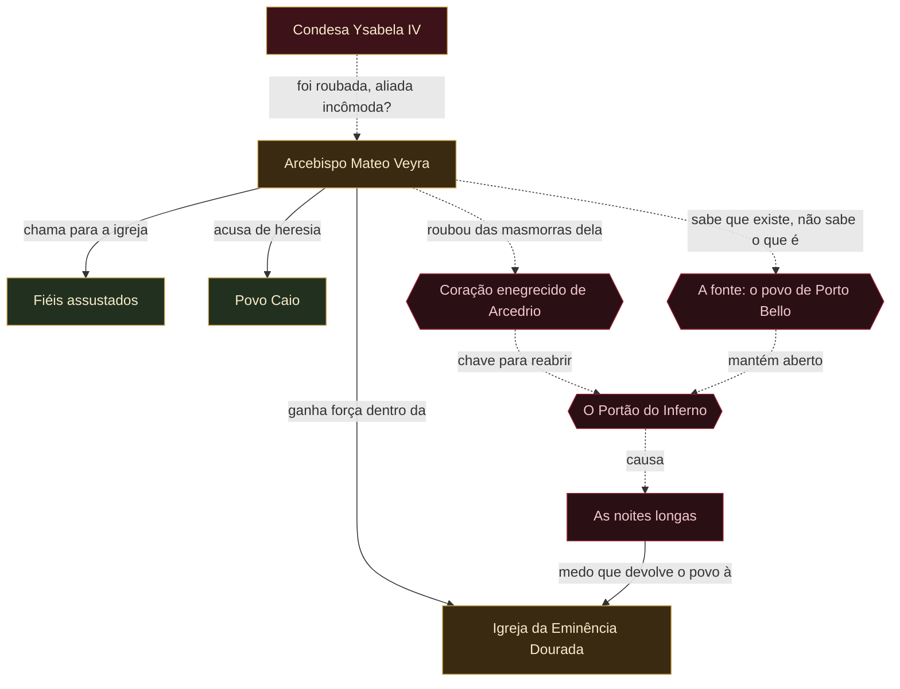
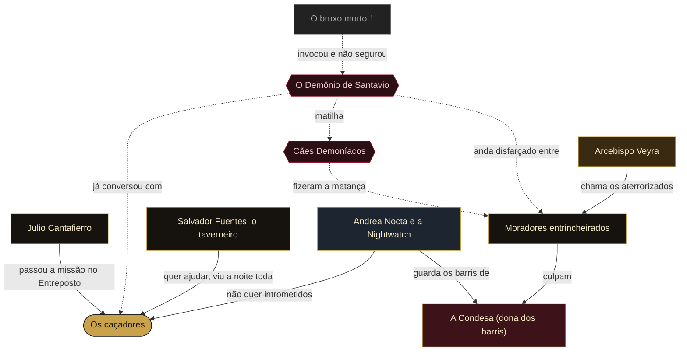
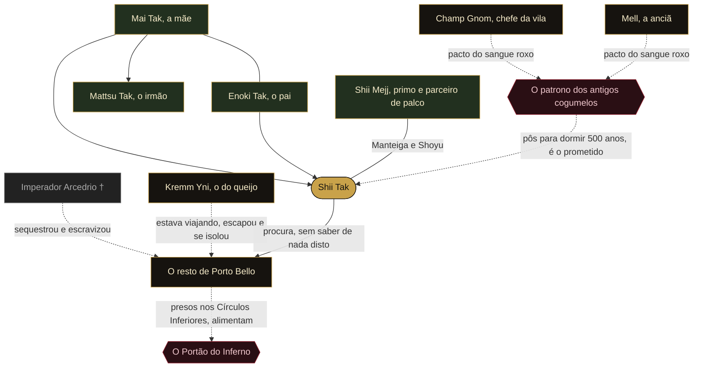

```ficha
```

> [!danger] Segredo do Mestre
> Estes diagramas mostram tudo, inclusive o que os jogadores não sabem. Linha cheia é coisa pública; linha tracejada é segredo.

## A campanha inteira



[[Arcebispo Mateo Veyra]] · [[Igreja da Eminência Dourada]] · [[Condesa Ysabela Delamoña IV]] · [[Conselho dos Cinco]] · [[Andrea Nocta]] · [[Nightwatch]] · [[Julio Cantafierro]] · [[Sombral Spade]] · [[Povo Caio]] · [[Imperador Arcedrio]] · [[O Portão do Inferno]] · [[O Demônio de Santavio]] · [[Porto Bello]]

## A intriga da igreja



Ver [[A Verdade por Trás das Noites Longas]] e [[O Segredo da Condesa]].

## Santavio



Ver [[Incidente Inicial - O Festival de Santavio]], [[O Demônio de Santavio]], [[Cães Demoníacos]], [[Salvador Fuentes]] e [[Santavio]].

## Porto Bello e a família de Shii Tak



Ver [[O Pacto de Porto Bello]], [[Porto Bello]], [[Shii Tak]], [[Kremm Yni]], [[Champ Gnom]], [[Mell]], [[Mai Tak]], [[Enoki Tak]], [[Mattsu Tak]] e [[Shii Mejj]].

> [!note] Como atualizar
> Cada diagrama é um bloco de texto `mermaid`. Uma linha `A -->|rótulo| B` desenha uma seta de A para B; com `-.->` ela sai tracejada. Para um laço novo, acrescente uma linha.
